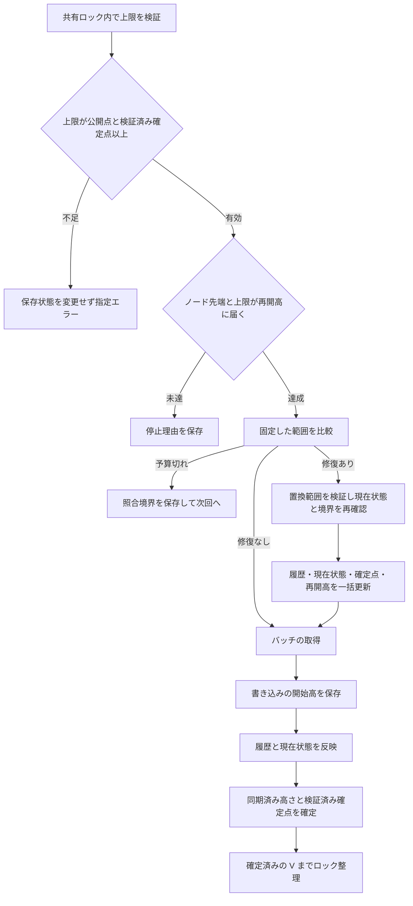

# Symbol Puller の確定チェーン照合と復旧

## 目的と範囲

Symbol ノードの確定チェーンを根拠に、旧版が公開した分岐上の末尾や途中で止まった書き込みを復旧する。対象は Symbol Puller、Symbol の PostgreSQL スキーマ移行、既存 REST 公開契約の検証。ノード切替、スケジューラの運用、NEM の処理は対象外。

## 外部インターフェース

| 境界 | 入出力と依存 |
|---|---|
| `symbol sync-block` | `--db-config`、`--symbol-node`、`--network` と任意の `--max-height` を使用。復旧待ち、安全停止、取得失敗は非ゼロ終了。 |
| `symbol refresh-accounts` | 同じ PostgreSQL ワークフローロックを取得。永続化された停止理由があれば書き込み前に理由をログへ出し、終了コード 0 でスキップする。 |
| `symbol recover-fork` | 共有ロック内で、連続無効化による停止に対する候補の高さ・ハッシュと確定チェーンを再検証する。通常同期への再開条件を満たした場合に限って停止を切り替える。 |
| `migrate_fork_recovery` | 既存 PostgreSQL に内部状態のテーブルとブロック変更の追跡を追加する。必須の接続設定は `[symbol_db]` に明示する。 |
| Symbol ノード | `/chain/info` のチェーン高さと `latestFinalizedBlock`、`/blocks/{height}` と `/blocks` のページから確定点と親リンクを照合する。復旧対象の現在状態は既存のリソース別 API から再取得する。 |
| Explorer REST | `/api/symbol/blocks`、`/api/symbol/account`、`/api/symbol/health` は既存の `symbol_sync_state` を読む。照合進捗と専用再開高は内部テーブルに保存する。 |

## 保存状態と公開範囲

| 状態 | 保存先 | 用途 |
|---|---|---|
| 同期済み高さ L とハッシュ | `symbol_sync_state` | 書き込みが完了した連続区間の末尾 |
| 物理末尾 | `symbol_blocks` | 未完了バッチと `--max-height` で残した行を含む |
| ノードの確定点 F | `/chain/info` | 照合と確定点の昇格に使うノードの観測値 |
| 未完了の書き込み開始高 dirty | `symbol_sync_state.dirty_state_from_height` | 再確認と再取得が必要な最初の高さ |
| 検証済み確定点 V | `symbol_fork_recovery` | ロールバックの下限とロック整理の上限 |
| 公開用確定点 P | `symbol_sync_state` | REST の `isFinalized` と投票鍵状態 |
| 旧版の履歴上端 T | `symbol_fork_recovery.legacy_history_height` | 旧版のロック履歴検査を適用する境界 |
| 再利用可能な上端 H | `symbol_fork_recovery` | 有効な上限で L を下げる前のチェックポイント |
| 照合進捗と再開高 | `symbol_fork_recovery` | 比較の継続と復旧後の書き込み再開 |

新規 DB は最初の書き込み前に高さ 0 とゼロハッシュを検証済み境界として記録する。バッチは親リンク、保存済みハッシュ、ノードの `/chain/info` の確定ハッシュを使って V を進める。途中バッチで F を検証できても公開値を維持し、実効チェーン先端のチェックポイントで F に到達している場合に公開値を更新する。公開 epoch が未設定の場合、REST のアカウント詳細は既存どおり 503 を返す。 単発の `/chain/info` が先端より高い確定点を返した場合は、その応答による修復・確定点の採用を保留する。保存済みブロックと具体的な矛盾がなく、dirty と専用再開高が残っていなければ、既存の公開状態を保持する。`backendSynced` は上限適用後のチェーン高さと L の一致に従う。

## 旧 DB の移行

### デプロイ前の確認

対象 DB に移行と同じ接続設定で接続し、PostgreSQL 14 以上であることと、セッションで有効なタイムアウトを確認する。初回移行は `CREATE OR REPLACE TRIGGER` を実行する。[PostgreSQL 14 リリースノート](https://www.postgresql.org/docs/14/release-14.html)

```sql
SHOW server_version;
SHOW statement_timeout;
SHOW lock_timeout;
```

本番に近いブロック件数と親リンクを持つステージング DB で、連続区間の全体走査時間、ブロックテーブルのロック待ち時間、ロック取得から解除までの時間を計測する。実環境の計測値は未確認。測定結果と運用要件に基づいてメンテナンス時間とタイムアウトを決める。制限を変更するときは根拠と運用上限を記録する。タイムアウトが発生した場合は、接続先と実効設定、ブロッカーを確認してから再実行する。

### 移行と再実行

1. 旧版・新版を問わず、同じ DB を使う手動・定期の Symbol Puller ジョブをすべて停止し、実行中のジョブが終了するまで待つ。復元可能な DB バックアップを確認する。
2. ジョブの再開前に、`explorer/puller` から `PYTHONPATH=.:.. python3 -m puller.workflows.migrate_fork_recovery --db-config <設定ファイル>` を実行する。移行は DB の共有ワークフローロック内で行う。
3. 移行の成功を確認してから `sync-block` を実行する。照合が予算で中断した場合は、同じ DB に対する次回の同期で保存済みの境界を再確認して続ける。移行待ちや安全停止の間、`refresh-accounts` は世代への書き込み前にスキップする。

未初期化 DB は `sync-block` と `refresh-accounts` からも暗黙に初期化される。明示的な移行を先に実行すると、ブロックテーブルのロックを伴う処理を予定した停止時間内に行い、同期やアカウント更新に先立って移行結果を確認できる。[移行 CLI](puller/workflows/migrate_fork_recovery.py)、[通常ジョブの初期化](puller/facade/SymbolPuller.py)

初期化は回復行の存在を照会する。初回だけ、別トランザクションの最初に `symbol_blocks` の `SHARE ROW EXCLUSIVE` を取得し、旧 DB の連続区間の走査と変更追跡トリガーの設置を同じトランザクションで行う。初期化済み DB は、この書き込みロックと初回の全体走査を省く。通常照合はブロックリビジョンが連続性の記録と異なるときに連続区間を再検査し、管理照合でも再検査する。旧 DB の照合が無効化されたときは、検査前後のリビジョンが一致した場合に限り保持候補の上端を更新する。[初期化と連続区間検査](puller/db/SymbolDatabase.py)、[再検査の条件](puller/facade/SymbolPuller.py)

失敗時はジョブを停止したまま、PostgreSQL のロックとタイムアウト、保存された停止理由、ブロック履歴、P・V・L、dirty、専用再開高、公開中のアカウント世代を確認する。原因を解消したら、既存の DB と回復行を保持して移行コマンドを再実行できる。

旧公開値は移行で変更しない。旧 P 以下を削除するには、実際の削除開始高で既存行とノードのハッシュが異なり、その分岐が共通点から生の確定ブロックまでの親リンクで証明される必要がある。欠損行、同じハッシュを持つ行の親リンク破損、ノード先端の短縮だけでは削除の根拠を満たさない。

## 履歴修復で使う置換ブロックの検証

履歴を削除して置き換える場合は、削除前に保持する親から書き込み上限までの置換ヘッダーを読み、親リンクと比較時の境界を確認する。分岐がなく、専用再開高をまだ持たない初回の dirty 修復にも同じ検証を適用する。全対象ヘッダーのハッシュを Core と同じ形式で再計算し、報告された `meta.hash` と照合する。ヘッダーの取引ルートとメタデータの件数が矛盾していれば、この段階で保留する。ロック復元が必要な場合は、後続ロックイベントを確認するために上限適用前の先端まで調べる。通常の前進同期は既存のバッチ取得から始める。

再取り込みでは事前に確認したヘッダーと再取得したヘッダーを照合し、取引本文から再計算した取引ハッシュと全トップレベル取引のルートを検証してから書き込む。レシートを検証するチェーンでは、レシートと解決ステートメントをヘッダーの `receiptsHash` に照合する。検証を無効にしたチェーンでは、事前照合と再取り込みの全範囲でゼロの `receiptsHash` と空の取引ステートメントを要求する。ロックイベントを含まないバッチもこの条件に従う。エイリアスの解決にヘッダーで立証できる根拠がなければ、対象バッチの書き込みを保留する。

照合の途中経過は DB リビジョンと修復境界に結び付けて保存する。修復コミットで記録した `replacement_proof` とロック復元根拠は、照合の途中経過を無効化した場合や管理解除後も保持する。上限変更、ノード先端の短縮、再起動の後は、今回到達できる範囲と重なる保存済みヘッダーを検証する。範囲の拡張に成功したときは、修復トランザクションで根拠を更新する。修復コミット後に証拠の矛盾を検出した場合は、そのバッチの書き込みと公開を保留し、保持したチェックポイント、dirty と専用再開高から再検証する。再開範囲のチェックポイントに成功したときは、両マーカーと対応する根拠を解消する。

### 旧版のロック履歴からの復元

初回移行は、書き込みを止めた旧 DB のブロック、取引とそのアドレス・モザイク関係、レシート、Hash Lock・Secret Lock の保存高の最大を、移行トランザクション内でロックを取得したうえで T（`legacy_history_height`）として記録する。T は欠番の有無にかかわらず旧版の保存範囲の上端を表し、以降の同期や移行の再実行で変わらない。新規 DB の T は NULL。上端列の導入前に移行した DB と、上端を立証できる履歴行がない旧 DB は T 不明として扱う。稼働済みの DB では `migrate_fork_recovery` を実行して列を追加する。初回の T を確定する前に旧版の書き込みを停止し、移行後は新版の同期を再開する。

`legacy_lock_history` が記録された DB では、削除開始高が T 以下、または T 不明の場合に削除開始高から末尾までを検査する。削除範囲が T より上に限られる場合は新規 DB と同じ修復経路を使う。すでにコミット済みの Hash Lock 再取り込み根拠は、対応するチェックポイントの確定まで再検証する。トップレベル取引の型番号と型名がともに `HASH_LOCK` を示し、`body.hash` と `raw_payload.transaction.hash` がともに 64 桁の 16 進文字列で大文字小文字を区別せずに一致し、同じ高さに対応する署名者行があれば、Hash Lock のキーを復元できる。保存済みの `LockHashCreated` レシートは、同じ高さで `secondaryId=0`、`primaryId=meta.index+1` を使い、唯一の作成レシートを唯一のトップレベル取引と結び付ける。取引の元の高さに加え、レシートの正規化済みの種別と生の種別番号が一致することを確認する。生の種別番号は JSON 数値または 10 進文字列で保持される。レシートの対象アドレスと署名者、解決済みモザイク ID、数量も照合する。[復元キーの照会](puller/db/SymbolDatabase.py)、[レシートの取り込み](puller/model/symbol/Receipt.py)

Catapult が作成するレシートにはロックハッシュがない。作成オブザーバーが現在のソースでレシートを記録し、トップレベル取引のソースは 1 始まりのため、レシートのソースと保存済み取引からキーを照合する。[HashLockObserver](https://github.com/symbol/symbol/blob/b3222548d6c81e3d0fdb5942a1848f554f37075b/client/catapult/plugins/txes/lock_hash/src/observers/HashLockObserver.cpp)、[NotificationPublisher](https://github.com/symbol/symbol/blob/b3222548d6c81e3d0fdb5942a1848f554f37075b/client/catapult/src/catapult/model/NotificationPublisher.cpp)、[BlockStatementBuilder](https://github.com/symbol/symbol/blob/b3222548d6c81e3d0fdb5942a1848f554f37075b/client/catapult/src/catapult/model/BlockStatementBuilder.cpp)

削除範囲の Aggregate Bonded は、トップレベル取引の `raw_payload.meta.hash` と保存済みの取引ハッシュが一致し、同じロックキーの作成・完了を高さとソース順で照合し、完了直前に有効だった作成を特定できる場合に復元対象に含める。作成レシートで元の所有者・解決済みモザイク ID・数量を照合し、ロックの現在行が残っている場合は、立証済みの作成イベントの値と照合する。共有する書き込み途中の範囲に保存件数の不足があるときは、その範囲の完了に先行する作成を保持履歴で確認し、現在行では確認できない後続イベントを正規チェーンから再取得して検査する。完了後にキーを再利用した作成が同じ修復範囲に含まれるときは、その作成も現在行との照合対象になる。同じブロック内では、一意なトップレベルのソースで前後関係を確認する。対応する `LockHashCompleted` が保存済みなら、ソースと返金内容も一致する必要がある。取引の書き込み後、完了レシートの書き込み前に中断した場合も、有効な作成を立証できればロックキーと返金先を特定できる。Aggregate Bonded の署名者と返金先は異なることがあるため、ロック所有者のアカウントも再取得する。[完了オブザーバー](https://github.com/symbol/symbol/blob/b3222548d6c81e3d0fdb5942a1848f554f37075b/client/catapult/plugins/txes/lock_hash/src/observers/CompletedAggregateObserver.cpp)、[ロックステータスと返金](https://github.com/symbol/symbol/blob/b3222548d6c81e3d0fdb5942a1848f554f37075b/client/catapult/plugins/txes/lock_shared/src/observers/LockStatusAccountBalanceObserver.h)

削除範囲ではレシートの正規化済みの種別と生の種別番号を照合する。生の番号が JSON 数値または ASCII の 10 進文字列で、任意の正符号、先頭のゼロ、空白、数字間の単一のアンダースコアを含む場合も照合できる。両者の一致を確認できない場合、Aggregate Bonded の完了直前に有効な作成を特定できない場合、作成や完了の対応に欠落・矛盾がある場合、または Hash Lock の期限切れや Secret Lock 関連のキーを立証できない場合は、`restoration_evidence_missing` で停止する。[ロックイベントの検査](puller/db/SymbolDatabase.py)

復元の基準は削除開始高の直前。ヘッダーの共通点がこの基準より後にあっても、ヘッダーの一致で未完了の取引・レシートの保存を認定しない。基準より前の作成と完了から、対象ロックのハッシュ・所有者・モザイク ID・数量・使用状態・終了高さを立証する。終了高さは作成高と `duration` の和。作成時は `Unused` で、対応する完了を確認すると `Used` になる。削除する枝だけの完了レシートは復元状態に影響しない。[作成オブザーバー](https://github.com/symbol/symbol/blob/b3222548d6c81e3d0fdb5942a1848f554f37075b/client/catapult/plugins/txes/lock_hash/src/observers/HashLockObserver.cpp)、[完了時のステータス更新](https://github.com/symbol/symbol/blob/b3222548d6c81e3d0fdb5942a1848f554f37075b/client/catapult/plugins/txes/lock_shared/src/observers/LockStatusAccountBalanceObserver.h)

ノードから再取り込み区間を読み、上限適用前の先端までブロックの親リンクを照合する。修復の事前照合と再取り込みでは、各対象ブロックのRESTヘッダーからCoreの形式でハッシュを再計算して `meta.hash` と照合する。通常ブロックでは通常フッターを除外し、重要度・ネメシスブロックでは対応するフッターを含める。検証済みヘッダーのルートを後続の照合に使い、トップレベル・全取引の件数も別途確認する。トップレベル取引は `meta.index` が 0 から連続することを確認してその順に並べ、全件の `merkleComponentHash` から Symbol SDK でルートを計算し、対象ブロックの `transactionsHash` と一致させる。Aggregate はトップレベル取引 1 件として扱い、別に取得した埋め込み取引は件数検査に含めるが、ブロックのルートに別の葉として追加しない。空ブロックのルートはゼロで、奇数の層では最後のハッシュを複製する。無関係な送金もルート照合に含める。保存が不完全な共有ブロックは、照合済みの正規チェーンから再取り込みする。 REST の本文から Catbuffer を再構築し、取引ハッシュと Merkle コンポーネントを再計算する。Aggregate は埋め込み取引のルートとコサイン署名も検証する。

Aggregate V2 と V3 では通常の埋め込みルートを計算する。V1 では通常計算と Core の `InvalidMerkleHashBuilder` を、葉のパディング有無と組み合わせた4通りで照合する。V1 で一致するルートがない場合、または `InvalidMerkleHashBuilder` でしか一致しない場合は、埋め込み本文を束縛できないものとして扱う。後者の計算では一部の葉がルートに反映されない。Puller は Core の既知の破損ハッシュ設定を受け取らないため、一致しない V1 が設定上の例外に該当するかは判定しない。 [Core の Aggregate 検証](https://github.com/symbol/symbol/blob/b3222548d6c81e3d0fdb5942a1848f554f37075b/client/catapult/plugins/txes/aggregate/src/validators/AggregateTransactionsHashValidator.cpp#L79)・[旧式の Merkle 計算](https://github.com/symbol/symbol/blob/b3222548d6c81e3d0fdb5942a1848f554f37075b/client/catapult/src/catapult/crypto/InvalidMerkleHashBuilder.cpp#L25)

V1/V2 のエンティティハッシュは `PayloadSize` を含まない。埋め込み件数や末尾の複製によってサイズを一意に確定できない場合も、埋め込み本文を強く束縛できないものとして扱う。再取り込みは、トップレベル取引のハッシュ・Merkle コンポーネント、ブロックの取引ルート、ソース、件数を検証して進める。V3 では埋め込みルートに加え、エンティティハッシュでペイロードサイズを照合する。

旧版のロック履歴検査では、通常またはパディング付きのルートと一致し、ペイロード長だけが曖昧な場合は、見えている埋め込み行を検査する。複製で隠れ得る葉は見えているため、Hash Lock・Secret Lock・Secret Proof があれば `restoration_evidence_missing` で削除前に停止する。`InvalidMerkleHashBuilder` でしか一致しない V1 と、どの計算とも一致しない V1 は、埋め込みロック取引の不在を立証できないため、見えている取引の型にかかわらず同じ理由で停止する。旧判定で保存したロック走査は再取得して検査する。Aggregate Bonded のロックキーは Core が参照するエンティティハッシュであり、Merkle コンポーネントを経由してブロックに束縛される。正規応答で必要な証拠がそろえば通常同期で再試行できる。旧履歴の証拠不足が続く場合は下記の管理復旧を使う。削除後の取引照合で矛盾した場合は、高さと原因を同期ログに記録し、既存の `reconciliation_wait` と再開マーカーを保持する。正しい応答で次回の同期を実行すると再取り込みできる。[Hash Lock の再取り込み証拠](puller/facade/HashLockReplayProof.py)、[Core の取引ルート計算](https://github.com/symbol/symbol/blob/b3222548d6c81e3d0fdb5942a1848f554f37075b/client/catapult/src/catapult/model/BlockUtils.cpp#L36)

Hash Lock の作成・完了はレシートのソース、所有者、モザイク、数量で立証する。作成取引がモザイクエイリアスを使うときは、通常同期と同じ処理で、作成高と取引ソースに適用される解決ステートメントからモザイク ID を得る。元の取引にはエイリアスを保存し、作成レシート・ロック応答と照合する値には解決済み ID を使う。事前照合で得た解決結果を保存し、照合の再開時と再取り込みで得た結果が一致することを確認する。事前照合の解決要求と再試行は HTTP 照合予算に含める。 同じ種類・高さ・未解決 ID に対する解決ステートメントは一つであることを確認する。単一のステートメント内にはソースが異なる複数の解決エントリを保持できる。

ノード REST の `enableVerifiableReceipts` が有効なチェーンでは、通常レシートとアドレス・モザイクの解決ステートメントを Catapult と同じ単位・順序でハッシュ化し、ブロックの `receiptsHash` に照合する。無効なチェーンでは、ゼロルートと空の取引ステートメントを検証する。Coreが `statementsCount` を省略した場合は、ゼロルートのブロックに限り件数をゼロとして保存する。

ゼロルートと空のステートメントを確認した場合、対象キーの先行履歴に欠落・矛盾がなく、削除範囲の作成を検証済みの正規取引と対応付けられれば、直接指定されたモザイクを持つ未期限・未使用の単一作成を復元できる。取引の署名者から求めた所有者、キー、解決不要のモザイク、数量、作成高と期間から求めた終了高、使用状態を現在のロック応答と照合する。レシートは生成しない。エイリアス、完了・再作成、期限到達、先行履歴が立証できない場合、または現在ロックの一致が確認できない場合は履歴を保持する。[レシートルートの計算](puller/model/symbol/ReceiptCommitment.py)、[取引本文と署名の照合](puller/model/symbol/TransactionCommitment.py)

`/lock/hash/{hash}` の最新応答は、後続イベントを適用した先端時点の状態と照合する。未検出を採用できるのは、保持範囲に作成候補や未解決の完了がなく、再取り込み区間にも作成がない場合か、同じキーの保持履歴と正規の再取り込み範囲の作成をすべて立証でき、その終了高さがすべて検証した確定高以下の場合。現在行がある場合は立証済みの作成とも照合する。Core は使用済みのロックに期限切れレシートを発行しない。期限切れによる返金だけではステータスは変わらない。[ロック履歴の確定時整理](https://github.com/symbol/symbol/blob/b3222548d6c81e3d0fdb5942a1848f554f37075b/client/catapult/plugins/txes/lock_shared/src/state/LockInfoHistory.h)

修復トランザクションには削除直前の状態を反映する。最新応答が後続の作成・完了を表す場合は、その値を前倒しせず、履歴から立証した値を保存する。対象ロックを再取り込みするときは、最後の検証済みブロックまで dirty と専用再開高を保持する。中断した場合はその開始高から照合し直し、再取り込み完了時にその高さでのロック状態と通常のチェックポイントを確定する。上限より後に、復元対象または確定後の整理対象に影響する Hash Lock 作成・完了がある場合は、書き込み前に `cap_blocks_dirty_repair` で停止する。上限外の無関係なキーは上限内の復旧を妨げず、ロック状態はその高さに達してから取り込む。上限を外すか、照合したイベントの高さまで届く上限を指定して再実行する。[削除前の復元と再取り込み](puller/facade/SymbolPuller.py)

取得済みページの走査位置は、照合に使った DB リビジョンと固定境界とともに保存する。検証した取引・レシートルートは高さとブロックハッシュに対応させて保存する。解決結果とロック照会は、固定した境界・復元根拠に対応する進捗として記録する。連続した先端伸長では、キーごとの期待状態、作成・完了による状態変化、確定による削除可否が変わらない照会結果を引き継ぐ。未照会のキーを先に進め、保存済み照会の再確認を既存予算内で完了する。根拠が変わったキーは再照会し、チェーンやDBリビジョンが矛盾したときは照合進捗を無効にする。レシート検証が無効なチェーンでは、再開時も区間ごとに空の取引ステートメントを再確認する。解決ステートメントが同じ高さで複数ページに分かれる場合、その高さ・種類ごとに次のページも記録する。修復をコミットするときは復元基準の状態と高さごとの証拠のダイジェストも再開マーカーと同じトランザクションで保存し、再起動後の照合で同じ範囲を確認する。再試行では前回の走査末尾のハッシュ・親・ルートを再確認し、次のページから続ける。取得途中の取引・レシートページを再利用するときは、対応するブロック範囲の高さ・ハッシュ・ルートを再確認する。ヘッダーを再計算した記録がない旧形式の走査進捗は、全対象を再取得・再検証してから使う。再取り込みバッチでは、各ブロックの高さ・ハッシュ・ルートと全トップレベル取引を照合し、解決結果が事前照合と一致してから書き込む。修復コミット前の最新 `/chain/info` の間では、共有ブロックと走査末尾のハッシュ・親・照合済みルートを再確認する。先端の前進だけでは無効化回数を増やさず、次回に追加範囲を確認する。取引やレシートの対応を立証できない場合は `restoration_evidence_missing` で履歴を保持する。

### 証拠不足で停止したロック履歴の管理復旧

T 以下の高さを含む削除範囲、または T 不明の移行済み DB の削除範囲に Secret Lock 作成・Secret Proof、対応する `LockSecret*`、または `LockHashExpired` が含まれ、現在の復元検査で状態を立証できない場合は `restoration_evidence_missing` のまま保持する。古い版の書き込み上限、リビジョン、現在行の有無だけでは、影響キーや復元状態を確定できない。取得先の変更や一時障害の解消などで必要な根拠がそろった場合は通常同期で再試行できる。現行の検査で扱えないイベントは、同じデータを使う限り通常同期で解消しない。 `recover-fork` の受付条件は `evidence_invalidated` のため、この停止理由には使えない。

次の手順で、未完了の範囲より前の検証済みチェックポイントを、独立した復旧先 DB に復元する。

1. 同期・アカウント更新の手動実行を止め、定期ジョブも停止する。停止した DB の完全なバックアップを取得し、停止理由、P・V・L とハッシュ、dirty、専用再開高、アカウント世代と公開マーカーを記録する。この DB とバックアップは調査用に保管する。
2. 同じネットワークの完全なバックアップを選定する。取得時の記録で、`healthy`、未完了のマーカーや停止理由なし、照合済みの P・V・L、修復が必要な範囲より前の連続履歴であることを確認する。復元先でブロックハッシュ・親リンクを正規ノードと照合する。履歴、ロックと他の現在状態、世代、マーカー、スキーマ・トリガー・シーケンスを同じチェックポイントから復元する。ロール、権限および DB の接続・タイムアウト設定も復元先で確認する。
3. バックアップは別名の空の DB に復元する。同じ PostgreSQL インスタンス内に、接続を閉じた検証済みのバックアップ DB がある場合は、管理接続から例えば次のように複製できる。例では `explorer_verified_backup` と `explorer_recovery_candidate` をそれぞれ対象インスタンスの実名に置き換える。複製先は未作成の名前を指定する。

   ```sh
   psql "$PG_MAINTENANCE_DSN" --set=ON_ERROR_STOP=1 \
     -c 'CREATE DATABASE explorer_recovery_candidate TEMPLATE explorer_verified_backup'
   ```

   論理バックアップを使う場合も同様に、検証済みのアーカイブを独立した復旧先に全体復元し、接続先と復元結果を確認する。チェックポイントや関連テーブルが欠けている場合は作業を止める。
4. 複製を使う Puller の設定で通常の `sync-block` を実行する。通常の照合とチェックポイントを通じて正規チェーンを再取得し、`healthy`、両再開マーカーと停止理由の解除、想定した確定点・同期済み高さ、ロック行とイベント、既存の公開世代を確認する。問題のイベントが正規チェーン上にある場合は、通常バッチから取り込まれる。復旧先の REST 公開とアカウント更新が正しいことを確認してから、運用上の切り替え手順に沿って接続先とジョブを切り替える。
5. 信頼できる前のバックアップがない、復元先とノードの境界が一致しない、または通常同期が安全停止する場合は、元の DB と証跡を保持して調査を続ける。停止理由やカウンタ、公開点、dirty を直接変更して公開を再開する操作は手順に含めない。

専用 PostgreSQL の回帰では、T 以下の高さで Secret Lock と作成レシートを含む中断、および Hash Lock の期限切れレシートを含む中断を扱う。T より上だけで中断した Secret Lock は通常の修復で再開できることも確認する。停止した DB と別の、検証済みチェックポイントから複製した DB で通常同期を再開し、正規チェーンの履歴とロック状態に収束することを確認する。

## 共通点探索の上限に達した場合

`common_point_limit` は、開始点から最大 10,000 高さの探索で共通点を確認できなかった停止を示す。`evidence_invalidated` は、固定した根拠の無効化が連続で 3 回に達した停止を示す。`recover-fork` が受け付けるのは後者だけ。停止理由は `symbol_fork_recovery.stop_reason` と同期ログで確認する。[共通点探索と無効化](puller/facade/ForkReconciliation.py)、[復旧コマンドの条件](puller/facade/SymbolPuller.py)

P・V・F がすべて 1、L・ローカルの物理末尾・ノード先端がすべて 10,002、相違が高さ 2 から始まる初期化済み DB では、`--max-height 1` で通常同期の比較範囲を狭められる。先の照合進捗が広い範囲を固定している場合、最初の上限付き実行は進捗を無効化して非ゼロ終了する。無効化が連続 3 回の停止に達していなければ、同じ上限で次回実行して L=1 のチェックポイントを確定できる。旧ブロックは高さ 10,002 まで物理的に残る。その後に上限なしで通常同期を実行し、分岐の証拠と復元条件がそろった時点で削除と再開高 2 の記録が行われる。削除後に前進同期が中断した場合、通常同期の再実行、または再開高に届く `--max-height 3` などで置換バッチを取り込める。

実行前に復元可能なバックアップを確保し、P・V・L、dirty、専用再開高、ローカルの物理末尾、ノードの先端と F、公開中のアカウント世代を記録する。上限には P と V の両方を下回らない正の整数を指定する。再開高へ届かない場合、未完了の範囲を安全に直せない場合、または修復が上限より高い保存済みブロックも削除する場合は、上限付き実行を保留する。ノード先端がローカルの物理末尾より低い場合は、生のノード先端が比較範囲を決めるため、比較範囲が実際に狭まることを確認する。条件が合わない場合や予期したチェックポイントを確認できない場合は、P・V、履歴、世代、再開マーカーを保持し、停止理由と DB・ノードの証拠を調べる。

P・V を手作業で下げたり、dirty・専用再開高・停止理由を SQL で消したりして再開条件を回避しない。

## 連続無効化による停止の解除

照合根拠が連続で 3 回無効になった場合、オペレーターは次のコマンドで、検証済み高さ V からノードの確定高さ F までの保持候補を再検証する。候補は、未完了の書き込みより前の範囲で DB とノードが共有するブロックを選ぶ。

```sh
PYTHONPATH=.:.. python3 -m puller.workflows.symbol recover-fork \
  --symbol-node https://symbol-node.example --network mainnet --db-config config.ini \
  --candidate-height 12345 --candidate-hash "$RETAINED_BLOCK_HASH"
```

`RETAINED_BLOCK_HASH` には候補ブロックの 64 桁の 16 進ハッシュを指定する。初回書き込みの途中で止まり、検証済み境界がジェネシスしかない場合は `--candidate-height 0` と 64 桁のゼロを指定する。通常のワークフローロックを取得できなければ非ゼロ終了する。

コマンドは DB の連続性、保存済み V、候補のハッシュと親、V から候補を経て生の F に至る親リンクを照合する。修復が必要な場合は通常同期と同じ削除・復元の条件を検証する。停止を解除する直前に `/chain/info` を読み、照合で固定した確定ブロックを再取得してから `/chain/info` を読み直す。指定誤りや証拠の矛盾、復元の失敗で履歴、P・V・L、dirty、専用再開高、世代、連続無効化回数は更新しない。

HTTP または SQL の予算で途中終了したときは、管理用の照合済みページを通常の照合進捗と分けて保存する。停止は維持する。同じ候補を指定して再実行すると、ノードの確定点が固定値と一致すること、保存済みの証拠と DB リビジョンが有効なことを再確認する。固定した前提が変わった場合は古い管理用証拠を破棄して非ゼロ終了する。次回は現在の証拠からやり直す。

照合が完了すると通常同期を再開できる。移行、修復、または再開高が残る場合は照合結果を通常同期へ引き継ぎ、通常のチェックポイントで解消するまで `refresh-accounts` を引き続き停止する。分岐や未完了の書き込みがない検証済み DB は、同期とアカウント更新を再開できる。

## 再開と書き込みの境界



照合は 100 件以下のページを使い、1 実行で 100 HTTP 試行・30 秒に制限する。共通点探索は開始点との差が 10,000 高さ以内の候補を対象とする。固定したノードの境界と DB のブロック変更を検査し、連続で 3 回根拠が無効になった場合は停止する。

| 状態 | 書き込み再開の条件 |
|---|---|
| 移行待ち | ローカルの保持候補とノードの確定チェーンを照合する。 |
| 照合待ち | 保存した範囲・ブロックハッシュ・親リンクを再確認し、最後の照合済み境界から続ける。 |
| 安全停止 | 確定チェーン、履歴、現在状態の各ガードに不足した根拠を満たす。照合根拠が連続で 3 回無効化された場合は、検証済みの復旧手順が必要になる。 |
| 再開待ち | ノード先端と上限が再開高に届き、保持末尾と取り込む先頭の親リンクが一致する。両マーカーは対象バッチのチェックポイントで解除する。 |
| 通常同期 | コミットが完了した連続区間を公開し、検証済み確定点までロックを整理する。 |

置き換えるブロックがある復旧では、コミット時に専用再開高と dirty を記録する。ノードの短縮で確定済み境界より上の不要な末尾だけを切る場合は、そのノードの先端に同期できる。先端または上限が再開高に届かなければ、履歴削除と世代整理を保留する。再開高を含むバッチのチェックポイントがコミットされるまで、両マーカーを保持する。上端 H は対象高さへの書き込み開始、履歴削除、およびアカウント更新ページの現在状態書き込みと同じトランザクションで無効化される。

## 検証と書き込みの安全条件

- 移行・同期・アカウント更新・管理復旧は、対象 DB の同じアドバイザリロックで同時実行を拒否する。
- ノード接続先は既存の Symbol ノード設定で検証する。照合では要求高さ、64 桁の 16 進ハッシュ、ページの連続性、親リンクを検証する。境界の証拠が変わった場合は照合進捗を無効にする。
- 上限が公開点または検証済み確定点より低い場合は、保存状態を変更する前に指定エラーにする。正の旧公開高さに対する同期済み高さや DB ハッシュの不整合、保持境界の不明、ロックや現在状態の復元根拠不足では履歴を保持する。
- 修復コミット、置換を完了する公開チェックポイント、管理コマンドによる停止解除の直前に `/chain/info` を再取得する。確定点の前進は、照合済みの保持履歴または認証済みの置換ヘッダーにある高さとハッシュに照らして確認する。後退、同じ高さでのハッシュの変化、認証済み範囲との矛盾、範囲外への前進では、その操作を保留する。公開直前の検査は同じ試行数・時間制限の下で、書き込みを終えた後に行う。今回の公開候補より新しい確定点を確認した場合は、次回同期の開始時にその確定点を採用できる。
- 修復と管理解除では、保存済みの照合で固定した確定ブロックと、今回のチェックポイントで採用できる確定ブロックのハッシュ・親リンクを再確認する。確定ブロックを読み直した後も、上限適用前のノード先端が証明済みの分岐開始高と確認した置換範囲に届くことを確認する。分岐開始高に届かない場合、末尾を切り詰める計画でノード先端が変わった場合、または今回採用できた F が再確認時に `max_height` を超えた場合は、削除と世代整理を保留し、次回の同期で比較し直す。これらの要求と再試行は修復前の照合予算に含める。
- 短縮修復の再確認中にノード先端が伸びた場合は、固定した確定ブロックと比較範囲の端点、削除境界を再検査する。証拠が一致した場合は、古い短縮計画を破棄して `reconciliation_wait` で次回の同期を待つ。連続無効化回数を据え置き、履歴と世代を保存する。ハッシュや親リンクが変わった場合、ノード先端が証明済みの短縮先端や分岐開始高に届かない場合、確定点が矛盾する場合は無効化として扱う。[修復直前の再確認](puller/facade/SymbolPuller.py)、[照合進捗の破棄](puller/facade/ForkReconciliation.py)
- DB の連続区間が V に届かない場合は、V の行のハッシュが一致しても停止する。再開時も同じ連続性を検証する。照合で使用したブロックリビジョンを、書き込み開始時とブロック書き込み時、または新規ブロックがない場合はチェックポイントで同じトランザクション内に検証する。ブロックを書いたトランザクションのリビジョンを次のチェックポイントに渡す。途中で別セッションによる変更を検出した場合は、P・V・L と連続性を更新せず、書き込み開始済みの範囲の dirty と専用再開高を引き継ぐ。
- 実効上限が生の F 未満の同期では、修復や dirty の再取得を行っても P と V を昇格しない。ロック整理はコミット済み V を使用する。チェックポイントが観測したノード先端に届かない間は、先端のロック応答を使う整理を保留する。上限付き修復で削除範囲に現在行があり、保持履歴では復元できず先端のロック応答が必要な場合は、修復も保留する。V 未登録の旧 DB は、F に届かない上限の間、移行待ちを維持する。
- 100 HTTP 試行と 30 秒の照合予算には、照合中のページ読取り、境界・確定情報の再確認と再試行を含める。30 秒には照合用 SQL、進捗保存も含まれ、照合用 SQL の `statement_timeout` は残り時間を上限とし、既存の設定がより短い場合はその設定を使う。初回移行と保持候補の連続区間の全体走査は独立した SQL 処理であり、照合の 30 秒枠には入らない。対象 DB の SQL・ロックのタイムアウトは別に適用される。比較に先立つチェーン情報・ネットワーク設定の取得、現在状態の再取得と前進同期には、それぞれ既存の要求制限を使う。
- 修復用の現在状態を取得する際に、性能ログの段階が `native_mosaic_fetch` に設定される。修復コミット直前の再確認が失敗した場合もこの段階名が残ることがある。原因の切り分けには、段階名とあわせて、保存された停止理由、実際の例外メッセージ、ノードが返した高さとハッシュを確認する。

## ノード取得失敗と REST 公開

公開済みのチェックポイントが `healthy` で、dirty・復旧停止・既知の履歴矛盾がなく、書き込み開始前に `/chain/info` などの取得が一時的に失敗した場合、同期は失敗をログに残して非ゼロ終了する。保存済みの公開状態を維持するため、従来 200 を返していたブロック一覧とアカウント詳細は、引き続きコミット済みのデータを HTTP 200 で返す。実行中に仮の照合進捗を書いた場合は、その実行が保存した進捗と DB リビジョンなどが一致する場合に限り取り消す。dirty や既存の復旧停止、確認済みの履歴矛盾、不正な成功応答にはそれぞれの安全停止条件を適用する。[同期失敗の処理](puller/facade/SymbolPuller.py)、[照合進捗の条件付き取消し](puller/db/SymbolDatabase.py)、[ノード応答の検証](puller/facade/SymbolPullerConnector.py)

今回の上限内の保持ブロックと `/chain/info` の F が矛盾し、その後の照合リクエストが失敗した場合は、安全停止を記録して履歴、P・V・L と公開世代を維持する。照合前のネットワーク設定やネイティブモザイクの取得に失敗した場合も、保存済みの同期範囲で F の矛盾を確認できれば `reconciliation_wait` を記録する。この判定では過去データの初期化や確定高の昇格を行わない。上端 H の一致を確認できた時点で照合可能な範囲を H まで広げる。F の採用には引き続きチェーンの照合が必要になる。ノードの HTTP エラーは、本文が有効な JSON の `null`、配列、スカラーでも HTTP 失敗として扱う。

コミット済みの V に達したロックの整理では、全ロックの状態を取得してから書き込む。取得の一時的な通信障害は同期エラーとして伝播し、コミット済みの healthy なチェックポイント、ロック行、公開世代を維持する。次回の同期は残った整理対象を再取得する。取得に成功した応答のロックキーや内容が不正な場合は安全停止する。

## REST 公開契約の検証

専用テスト DB の接続設定と Puller・REST 両方の依存を用意し、Linux CI イメージの `explorer/puller` から直列で実行する。

```sh
PYTHONPATH=.:..:../rest python3 -m pytest --asyncio-mode=auto -v \
  tests/facade/symbol/test_PullerForkRecovery.py::SymbolPullerForkRecoveryTest::test_rest_reads_public_values_at_a_capped_puller_checkpoint \
  tests/facade/symbol/test_PullerForkRecovery.py::SymbolPullerForkRecoveryTest::test_rest_marks_capped_blocks_finalized_after_the_puller_publishes_finality \
  tests/facade/symbol/test_PullerForkRecovery.py::SymbolPullerForkRecoveryTest::test_rest_updates_voting_key_status_when_the_puller_publishes_a_new_epoch \
  tests/facade/symbol/test_PullerForkRecovery.py::SymbolPullerForkRecoveryTest::test_rest_reports_unhealthy_status_after_a_puller_recovery_stop \
  tests/facade/symbol/test_PullerForkRecovery.py::SymbolPullerForkRecoveryTest::test_rest_preserves_committed_reads_during_prewrite_node_transport_failures \
  tests/facade/symbol/test_PullerForkRecovery.py::SymbolPullerForkRecoveryTest::test_rest_preserves_committed_reads_when_retained_block_returns_http_503_with_json_null \
  tests/facade/symbol/test_PullerForkRecovery.py::SymbolPullerForkRecoveryTest::test_rest_preserves_committed_reads_when_lock_cleanup_transport_fails_then_retries \
  tests/facade/symbol/test_PullerForkRecovery.py::SymbolPullerForkRecoveryTest::test_rest_preserves_committed_reads_during_transient_finality_ahead_of_tip
```

同じ DB に対して Puller のチェックポイントと REST のルートを使う。上限付き同期、公開 epoch が空のときの 503、確定後のブロック表示、`totalTransactions` と `topLevelTransactions` の区別、ノード epoch の更新による投票鍵の状態、復旧停止時のヘルスを検証する。通信障害のテストは公開済みのアカウント世代と `valid_run_id` を用意し、書き込み前の失敗後も世代とブロック一覧・アカウント詳細の 200 応答が保持されることを確認する。保持ブロックが HTTP 503 と JSON の `null` を返すケースでは、実際の HTTP 接続を通して 3 回試行することも確認する。ロック整理の通信障害と再試行では、実際に整理対象になったロック行と REST の 200 応答を検証する。8 件すべてが実行され、スキップが 0 件であることを確認する。
